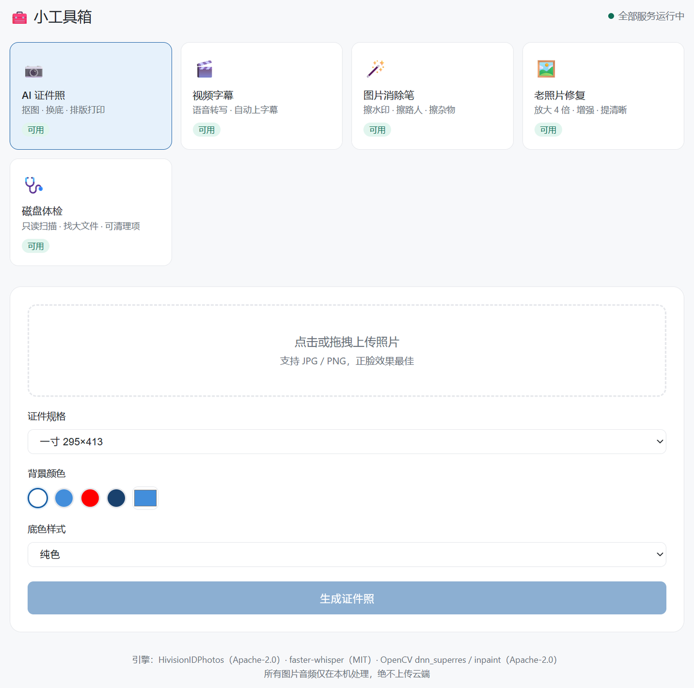

# 小工具箱（AI Toolbox）

六个常用小功能，装进一个本地窗口。**全部推理在本机完成，图片和录音不上传。**



做这个的起因很具体：证件照、字幕、擦水印、放大、清磁盘、转格式这六件事，散在六个网站，
每一件都要先上传、等进度条、再注册。挪到自己机器上之后，这些步骤没有了。

## 功能

| 工具 | 能做 | 引擎 |
|---|---|---|
| AI 证件照 | 抠人换底、一寸 295×413 / 二寸 413×579、六寸排版打印 | [HivisionIDPhotos](https://github.com/Zeyi-Lin/HivisionIDPhotos) |
| 视频字幕 | 语音转写导出 SRT；把字幕**烧进画面**输出新视频 | SenseVoice（sherpa-onnx）+ ffmpeg |
| 图片消除笔 | 涂抹擦除水印、路人、小杂物 | OpenCV Telea inpaint |
| 老照片修复 | 2/3/4 倍放大 + 锐化 | OpenCV dnn_superres（EDSR / FSRCNN） |
| Word ⇄ PDF | 双向转换，按文件头自动判方向；PDF 回来的是可编辑近似稿 | 本机 Microsoft Word（COM） |
| 磁盘体检 | 只读扫描，找大文件夹、大文件、可清理项 | 纯 Python |

## 架构

```
xiaoGongJuXiang.exe            桌面启动器（PyInstaller 打包 launcher.py）
        │
        ├── 拉起 8080  deploy_api.py    → HivisionIDPhotos 证件照服务
        └── 拉起 8081  toolbox_api.py   → 字幕 / 消除笔 / 放大 / 磁盘体检
                        │
                        └── 前端 index.html（pywebview 窗口，Edge --app 兜底）
```

两个后端各自独立，8081 挂了不影响 8080。启动器只管理自己拉起的进程，
关窗口时自动退出，不会误伤你已开的其他 Python 程序。

## 本地跑起来（开发模式）

```bash
git clone https://github.com/<you>/ai-toolbox.git
cd ai-toolbox
python -m venv .venv && .venv\Scripts\activate
pip install -r requirements.txt
```

两个后端分别启动：

```bash
# 8081：字幕 / 消除笔 / 放大 / 磁盘体检
cd app && python toolbox_api.py

# 8080：证件照（需要先装 HivisionIDPhotos，见下）
cd backend && python deploy_api.py
```

然后浏览器打开 <http://127.0.0.1:8081/> 即可。

### 证件照服务依赖

`backend/deploy_api.py` 是对 [HivisionIDPhotos](https://github.com/Zeyi-Lin/HivisionIDPhotos)
的 FastAPI 封装，本身不含它的人像分割模型。按上游 README 装好后，把它的包放进 Python 环境：

```bash
pip install -r HivisionIDPhotos/requirements.txt
# 或者把 HivisionIDPhotos 目录加入 PYTHONPATH
```

模型（`hivision_modnet.onnx` 等）从上游发布页下载，放到 `backend/models/`。
不放这两个东西，**其他四个功能照常可用**，只有证件照会报错。

### 模型放哪

```
app/models/sensevoice/   SenseVoice 语音模型（model.int8.onnx + tokens.txt）
app/models/sensevoice/  SenseVoice 模型（随包分发，无需下载）
backend/models/          EDSR_x4.pb / FSRCNN_x4.pb
```

超分模型缺失时不会崩，会退回 Lanczos 插值 + 锐化，并在接口返回里
注明 `engine: "LanczosFallback"`——你能一眼看出这次是模型放大还是普通放大。

## 打包成便携版

```bash
pip install pyinstaller
pyinstaller xiaoGongJuXiang.spec
```

产物在 `dist/`。要分发给别人，还需要把 `runtime-tools/`、`runtime-hivision/`、
`backend/`（含模型）一起放进同一个目录，参考打包好的
`portable/AIToolbox/` 结构，整个文件夹约 1.5 GB。

> 便携版注意：解压到**纯英文路径**（如 `D:\AIToolbox`）。OpenCV 不认中文路径，
> 放中文目录会导致证件照服务启动失败。

## 几个实现上的注意点

- **烧字幕**用 ffmpeg 的 `subtitles` 滤镜 + libass。SRT 写成带 BOM 的 UTF-8，
  否则 libass 会把中文认成乱码；自定义字体走 `fontsdir` 参数，绕开路径转义问题。
- **磁盘扫描**跳过 reparse point（junction / 符号链接），不然体积会虚报。
- **图片消除笔**的 mask 任何明显笔迹都算擦除区（灰度 > 20），并做一次膨胀盖住笔迹边缘。
- **透明 PNG** 在浅色页面上看不出来，测试时把结果贴到深色底上更容易发现残留。
- **Word ⇄ PDF** 不引入第三方转换库，直接调本机 Word 的 COM 接口（`Word.Application`），
  所以机器上必须装了 Microsoft Word；PDF 转回来是「可编辑的近似稿」，扫描件和复杂表格会失真。
  转换先写临时目录再 `shutil.move` 到 `Downloads\AIToolbox`，避免直接写目标目录偶发的命令失败。
  上传文件名可能是 RFC2047 编码（`=?utf-8?B?...?=`），落地前要解码并清掉 `<>:"/\|?*` 等非法字符。

## 协议

本项目代码使用 [MIT](LICENSE)。

第三方组件遵循各自协议，**分发时请一并保留**（完整清单见 [THIRD_PARTY_NOTICES.md](THIRD_PARTY_NOTICES.md)）：

| 组件 | 协议 |
|---|---|
| HivisionIDPhotos | Apache-2.0 |

| SenseVoice（sherpa-onnx 推理） | Apache-2.0 |
| EDSR / FSRCNN 模型 | Apache-2.0 |
| OpenCV | Apache-2.0 |
| HarmonyOS Sans 字体 | 华为 HarmonyOS Sans 字体协议（可商用，但不可单独售卖） |

字体与模型**不在本仓库内**，需自行下载。Word ⇄ PDF 依赖你机器上已安装的 Microsoft Word，不属于本仓库分发内容。

## 已知限制

- 只支持 Windows（启动器用了 `win32com`、`winreg`）。
- 字幕转写对否定词、专有名词容易吞字，正式发布前建议人工过一遍。
- 超分需要带 `dnn_superres` 的 OpenCV 构建（`opencv-contrib-python`）；
  官方 `opencv-python` 没有这个模块，会退化到插值。
- 老照片修复只做放大增强，不做人脸修复、划痕修补。


